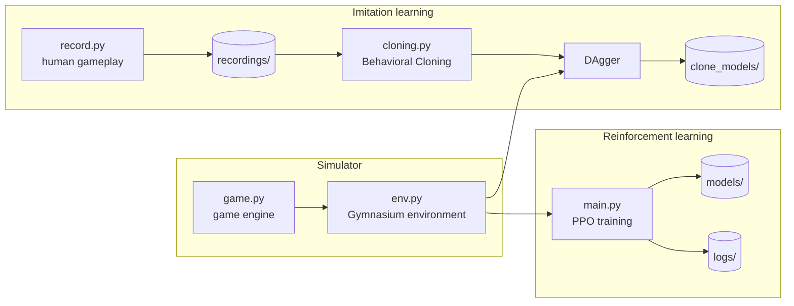

# Flappy AI

**An end-to-end machine learning project: a custom Flappy Bird simulator, a reinforcement learning environment, and two different approaches to training an agent to play it.**


---

## Overview

Flappy Bird is a small game with a hard learning problem inside it: the agent gets one sparse signal (survive or crash) and has to learn *when* a single button press is worth it.

This project builds everything around that problem, from the game itself to the training pipelines:

1. **Simulator.** A Flappy Bird engine written in Python with pygame, with physics, scrolling obstacles and pixel-accurate collision detection.
2. **RL environment.** The engine is wrapped in a standard [Gymnasium](https://gymnasium.farama.org/) interface, so any compatible algorithm can train against it.
3. **Reinforcement learning.** A PPO agent trained with [Stable-Baselines3](https://stable-baselines3.readthedocs.io/), with TensorBoard logging and checkpointing.
4. **Imitation learning.** A tool for recording human gameplay, plus Behavioral Cloning and DAgger pipelines built on the [`imitation`](https://github.com/HumanCompatibleAI/imitation) library.

## Highlights

- **Custom simulator** that doubles as a playable game and a fast, headless-capable training environment
- **Gymnasium-compliant environment** with a compact, normalized observation space
- **Two learning paradigms** applied to the same task, so they can be compared directly: reinforcement learning and imitation learning
- **Human-in-the-loop data collection**: play the game yourself to generate training data
- **Reproducible experiments**: auto-numbered runs, saved checkpoints and TensorBoard logs

## Architecture



## Getting started

### Prerequisites

- Python 3.10+
- A display, since pygame opens a window

### Install

```bash
git clone https://github.com/Rotorwing/flappy-ai.git
cd flappy-ai

python -m venv .venv
source .venv/bin/activate        # Windows: .venv\Scripts\activate

pip install pygame numpy gymnasium stable-baselines3 imitation tensorboard
```

### Usage

```bash
# Play the game yourself (SPACE or UP to flap)
python src/game.py

# Train a PPO agent
python src/main.py

# View training progress
tensorboard --logdir src/logs

# Record your own gameplay (close the window to save)
python src/record.py

# Train and evaluate an imitation-learning agent from the recordings
python src/cloning.py
```

## Project structure

```
flappy-ai/
├── src/
│   ├── game.py           # Game engine
│   ├── env.py            # Gymnasium environment
│   ├── main.py           # PPO training
│   ├── record.py         # Human gameplay recorder
│   ├── cloning.py        # Behavioral Cloning + DAgger
│   ├── flappy.py         # Original standalone prototype
│   ├── assets/           # Sprites and audio
│   ├── recordings/       # Recorded demonstrations
│   ├── clone_models/     # Imitation-learning policies
│   ├── models/           # PPO checkpoints
│   └── logs/             # TensorBoard logs
└── LICENSE
```

## Skills demonstrated

- **Machine learning:** reinforcement learning (PPO), imitation learning (Behavioral Cloning, DAgger), policy evaluation
- **Python engineering:** object-oriented design, modular project layout, file and experiment management
- **Tooling:** Gymnasium, Stable-Baselines3, imitation, PyTorch, TensorBoard, pygame, NumPy
- **Applied problem solving:** turning an open-ended task into a well-defined learning problem, then comparing approaches to it

## Status

This is an experimental project and a work in progress. The simulator, environment and both training pipelines are in place and runnable. Benchmarking the trained agents against each other is the next step.

## Roadmap

- Evaluation script to benchmark saved agents on a common metric
- Reward shaping experiments for the RL agent
- Fine-tune the RL agent starting from the imitation-learning policy
- Training curves and a demo GIF in this README
- Pinned dependency versions (`requirements.txt`)

## Acknowledgements

Flappy Bird was created by Dong Nguyen. This is an unaffiliated, educational recreation. Built with [pygame](https://www.pygame.org/), [Gymnasium](https://gymnasium.farama.org/), [Stable-Baselines3](https://stable-baselines3.readthedocs.io/) and [imitation](https://imitation.readthedocs.io/).

## License

Released under the [MIT License](LICENSE).
